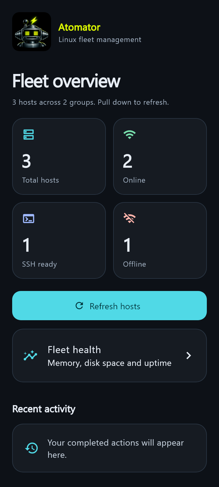

# Mobile experience improvements

Based on upstream main at 3ebb5d1 (app version 1.7.2).

## Changes

- Replaced the large dashboard banner and crowded five-column statistics with a compact identity header and responsive metric cards.
- Added pull-to-refresh, a clear primary refresh action, an add-host entry point, and a recent-activity empty state.
- Updated shared colors, typography, cards, form fields, and navigation styling.
- Preserved tab state, including the SSH terminal, when moving between screens.
- Added host search by name, IP, group, or MAC, combined with online/offline/SSH-ready filters.
- Clarified that deleting a filtered group still removes its entire membership.
- Fixed job history ordering to show the latest jobs first.
- Fleet health now uses per-host credentials, at most five concurrent connections, validates readings, and reports unavailable data. Failed readings no longer produce a healthy disk claim or invented uptime.
- Prevented overlapping host scans, bounded reverse DNS lookup time, and reset the scan state in a finally block.
- Added regression tests and a pull-request verification workflow.

## Preview

Rendered Flutter dashboard using synthetic host data, not a live network scan:

## Validation

Five automated tests cover health parsing, missing readings, job history, a 360-pixel phone layout with enlarged text, and combined host search/status filtering.

Commands: `flutter analyze --no-pub lib test` and `flutter test`.

The optional local screenshot capture uses ATOMATOR_CAPTURE=1 on Windows. CI does not depend on local fonts or screenshot files.

## Device checks before release

Verify terminal session continuity when switching tabs, keyboard/system navigation insets, large host lists, custom credentials on an actual Linux host, and background/foreground lifecycle behavior. Automated tests do not establish remote SSH interoperability.

Existing SSH command wrapping, release version, signing, and update behavior are unchanged. This branch is for review and device validation before a signed release.

Android debug APK compilation also passed locally using Flutter 3.41.9 and Java 17. This verifies compilation only, not live SSH behavior or production release signing.
